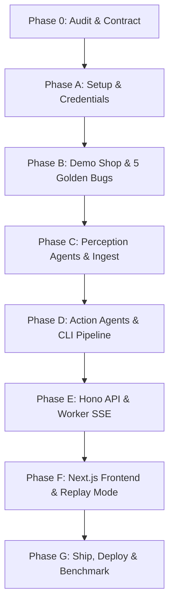

# Replay: Implementation Decisions & Requirements Baseline

This document tracks requirements, architectural decisions, and resolutions to discrepancies between the **Replay: Hackathon Build Plan (PDF)**, the **Master Build Prompt**, provider documentation, and local environment state.

---

## 1. Requirements Checklist & Baselining

| Area | Requirement | Baseline Decision | Source / Justification |
|---|---|---|---|
| **Monorepo Structure** | pnpm workspaces, strict TypeScript, Node.js 22 LTS (Host running Node v24.18.0) | `pnpm` workspaces with `apps/web`, `apps/api`, `packages/agents`, `packages/sandbox`, `packages/video`, `packages/storage`, `packages/db`, `packages/shared`, `targets/demo-shop` | Master Prompt & Plan §Tech Stack |
| **API & Worker Architecture** | Single backend codebase with separate entry points | `apps/api/src/server.ts` (Hono HTTP + SSE) and `apps/api/src/worker.ts` (background queue processor) | Master Prompt Architecture section |
| **AI Inference Provider** | Nebius Token Factory via OpenAI-compatible SDK | Configured via `OPENAI_BASE_URL` (or `NEBIUS_BASE_URL`) + API key. Exact model IDs verified via `scripts/smoke.ts` | Plan Page 2 & Master Prompt |
| **Model Allocation** | 4-model split across 6 agent roles | • Watcher: `nvidia/Nemotron-3.5-Super-VL` • Locator: `nvidia/Nemotron-3_5-Lightning` • Reproducer: `nvidia/Nemotron-3-Ultra-550b-a55b` • Verifier: `nvidia/Nemotron-3.5-Super-VL` • Fixer: `nvidia/Nemotron-3-Ultra-550b-a55b` • Reporter: `nvidia/NVIDIA-Nemotron-3-Nano-30B-A3B` | Plan Page 6 & Master Prompt |
| **Planted Demo Bugs** | 5 planted bugs in Demo Shop | 1. Cart total becomes NaN after clearing quantity 2. Double-clicking Apply applies discount twice 3. String sort puts $100 before $20 4. Checkout accepts empty email 5. Quantity resets after page navigation | Reconciles Page 1 (mentions 4 target bugs) with Page 30 Step 7 (defines all 5 bugs) |
| **Persistence & Replay Mode** | Supabase Postgres + Storage with local fallback | Drizzle ORM schema for `targets`, `runs`, `run_events`, `artifacts`. Finished runs replayed in UI with 0 backend dependencies | Plan Page 3 & Master Prompt |
| **Truthful Execution Gate** | Strictly real test runs | No mock passes, no assumed diffs, no weakened assertions. A fix is verified *only* when the generated Playwright test and original suite pass | Non-negotiable Engineering Rules |

---

## 2. Identified Discrepancies & Resolutions

### Decision 001: Number of Planted Bugs (4 vs 5)
- **Conflict:** Page 1 of the PDF mentions "4 planted bugs in a demo app reproduced and fixed", while Page 30 (Step 7) and Master Build Prompt list 5 specific bugs.
- **Resolution:** Implement all 5 bugs in `targets/demo-shop`. This satisfies both the 4-bug minimum benchmark target (>= 3 of 4 green) and gives full coverage for the 5 golden evaluation clips.

### Decision 002: Backend Packaging (`apps/api` vs root scripts)
- **Conflict:** Some parts of the PDF refer to standalone script loops, while the Master Prompt specifies `apps/api/src/server.ts` and `apps/api/src/worker.ts`.
- **Resolution:** Standardize on `apps/api` with dual entrypoints:
  - `apps/api/src/server.ts` for Hono REST API and SSE event stream.
  - `apps/api/src/worker.ts` for the queue worker using atomic run claims (`FOR UPDATE SKIP LOCKED`).
  - `pnpm replay <video>` CLI in `packages/agents` or workspace root calling the deterministic pipeline directly.

### Decision 003: Node & Package Toolchain
- **Observation:** Host has Node v24.18.0 installed (Plan baseline is Node 22 LTS). `pnpm` 12.15.0 enabled via Corepack.
- **Resolution:** Node 24 is backward-compatible with Node 22 for ESM, strict TypeScript, Next.js 15, and Hono. Target Node 22+ engine in `package.json`.

### Decision 005: Inference provider: NVIDIA Build API (supersedes Nebius Token Factory)
- **Date:** 2026-10-25. Keys generated on https://build.nvidia.com/settings/api-keys (four designated keys, one per model family). The earlier OpenRouter assumption was wrong; the repo never contained OpenRouter config: this decision replaces the Nebius Token Factory baseline above.
- **Endpoint:** `https://integrate.api.nvidia.com/v1` (OpenAI-compatible SDK), auth via `NVIDIA_API_KEY` plus optional per-role `NVIDIA_API_KEY_<ROLE>`.
- **Models:** `nvidia/nemotron-3.5-super-vl-120b-a12b` (Watcher+Verifier), `nvidia/nemotron-3.5-lightning-30b-a3b` (Locator), `nvidia/nemotron-3-ultra-550b-a55b` (Reproducer+Fixer), `nvidia/nemotron-3-nano-omni-30b-a3b-reasoning` (Reporter). Native NVIDIA IDs, no `:free` suffix.
- **Central map:** `packages/agents/src/llm.ts` (`AGENT_MODEL_DEFAULTS`, `resolveModel`, `resolveApiKey`) is the single role→model→key source of truth. Live verification: `pnpm smoke`.

### Decision 004: Host Dependencies (Docker, ffmpeg, ripgrep)
- **Observation:** Docker binary exists but points to Colima socket (`~/.colima/default/docker.sock`) which is inactive; `ffmpeg` and `ripgrep` are not yet on PATH.
- **Resolution:**
  - Phase A/B can proceed immediately (workspace scaffolding, database schema, demo shop, baseline tests).
  - Install `ffmpeg` and `ripgrep` via Homebrew before Phase C (Perception / Frame Extraction).
  - Start Colima (`colima start`) before Phase D (Sandbox Docker Runner).

---

### Decision 006: Provider reality (2026-10-27): supersedes the endpoint half of Decision 005
- **Conflict:** Decision 005 named Nebius Token Factory endpoints, but no Token Factory key was ever provisioned; the working credentials are NVIDIA Build keys.
- **Resolution:** the env-var NAMES stay `NEBIUS_*` (central map in `packages/agents/src/llm.ts`), and `.env` points `NEBIUS_BASE_URL` at `https://integrate.api.nvidia.com/v1` with the working NVIDIA Build keys. `pnpm smoke:models` verifies 4/4 roles live. Model IDs in use are the NVIDIA Build catalog variants (lowercase, e.g. `nvidia/nemotron-3.5-lightning-30b-a3b`); if a Token Factory key arrives, only `.env` changes.

### Decision 007: API mounting and container format (2026-10-27)
- The Vercel `hono` services builder emits ESM and loads it as CJS regardless of entry format: FUNCTION_INVOCATION_FAILED on every /api call. The API is therefore mounted **inside the Next service** at `apps/web/app/api/[[...route]]/route.ts` (standard Hono-on-Next pattern); `vercel.json` has a single `web` service.
- Docker: pnpm's symlinked node_modules does not survive Docker COPY, so the containers run self-contained esbuild CJS bundles (`apps/api/api-dist/server.cjs`/`worker.cjs`). `import.meta.url` is undefined in CJS bundles: prompt loading and repo-root resolution use `moduleDirOf()` with cwd/`REPLAY_PROMPTS_DIR` fallbacks.

## 3. Dependency Graph & Phase Sequencing

- **Critical Stop-Work Gate:** Frontend implementation (Phase F) must NOT start until Phase D Step 20 passes end-to-end via CLI:
  `video -> timestamped bug report -> code suspects -> failing test (red) -> verified patch -> passing test (green) + suite -> report`.
