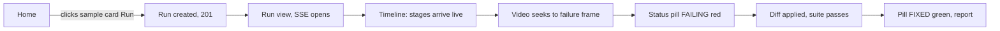
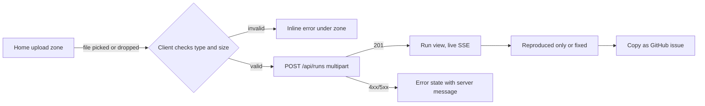
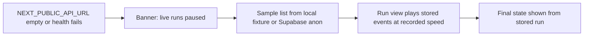

# Replay User Flows

## Flow 1: Judge, first visit to red and green

Screen states: Home (samples loaded) -> Run view (loading skeleton) -> Run view (running, amber) -> Run view (fixed, green) with report rendered. A judge who reads nothing still sees the pill flip. Purpose understood in 30 seconds: the hero line plus one sample card state the whole product. Red to green in under 2 minutes depends on the pipeline; replay mode guarantees the same sequence from stored events.

## Flow 2: Developer uploads a video

States: dropzone idle, drag-over, uploading (button spinner), created (redirect), error (server message shown inline, e.g. 413 too large, 415 wrong type).

## Flow 3: Replay mode, backend offline

The banner reads: "Live runs are paused. You are watching a recorded run." No live-run affordances are shown in this mode (upload disabled with a one-line reason).

## Flow 4: Failure paths

| Failure | User sees | Next action |
| --- | --- | --- |
| Video over 50MB or wrong type | Inline error under the dropzone with the server's message | Pick a different file |
| Upload network error | Error state, "Could not reach the backend" | Retry button |
| Run unreproduced | Status pill UNREPRODUCED, timeline shows which stage stopped, Watcher summary shown | Try another sample or download the report |
| Reproduced, fix not verified | Pill REPRODUCED ONLY, diff shown labeled "proposed, not applied" or applied-but-failed reason | Copy the issue, download the test |
| Run failed | Pill FAILED, failing stage with its error event expanded | Rerun when backend returns |
| Backend down | Banner plus replay mode | Watch a recorded run |
| SSE drops | Hook reconnects with backoff, de-duplicates by seq | Automatic; timeline shows "reconnecting" if over 5s |

## Screen state table

| Screen | Loading | Empty | Error | Success |
| --- | --- | --- | --- | --- |
| Home | Sample card skeletons | "No samples available" | API unreachable: banner, replay mode offered | Cards with real frames |
| Run view | Layout-matched skeleton | Run not found message | Run fetch failed, retry | Full three-column workspace |
| Benchmark | Table skeleton | "No runs yet" | Same as Home | Real results table |
| How | None (static) | None | None | Static content |
